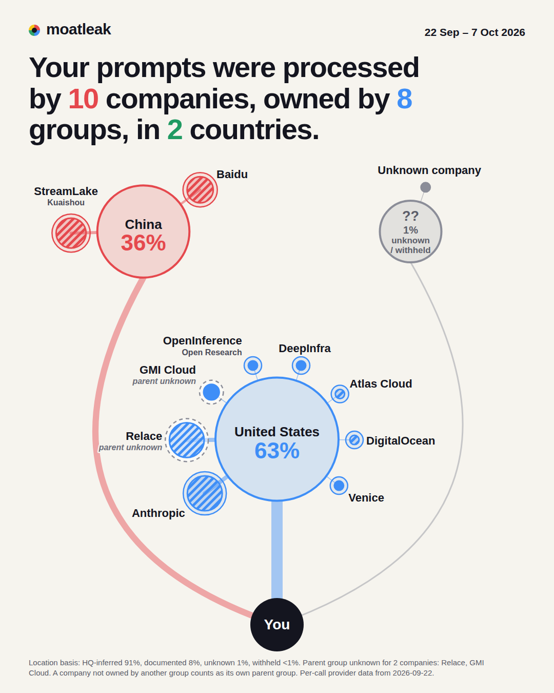
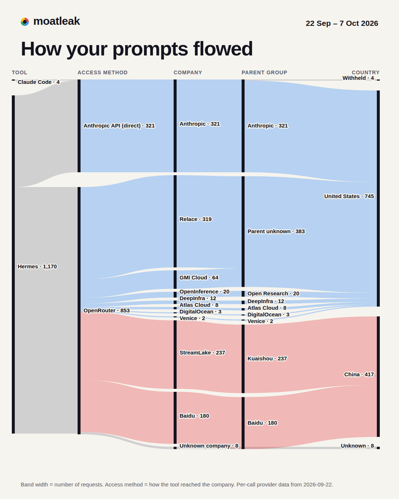

# moatleak

moatleak is a free, open-source command-line tool. It reads the AI-tool logs already on a user's machine and shows
which companies processed their prompts, who owns those companies and which countries they sit in. Everything runs
locally, uses only the Python standard library, and the scan makes no network calls.

Find out which companies, parent groups and countries processed your AI prompts, using logs already on your machine.



moatleak reads the local records your AI tools already keep, looks each serving company up in a sourced registry,
and writes one offline HTML report. `scan` runs entirely on your machine and uses only the Python standard
library, with no dependencies.

## Quick start

Needs Python 3.11 or newer on Linux or macOS. Not on PyPI yet, so install from a checkout:

```
git clone <this repository>
cd moatleak
python3 -m venv .venv
.venv/bin/pip install .
.venv/bin/moatleak sources
.venv/bin/moatleak scan
```

`moatleak sources` shows which data sources were detected, with row counts. `moatleak scan` writes into
`./moatleak-report/`; open `moatleak-report/report.html` in a browser.

## What it reads

Read-only, under your home directory (change it with `--home DIR`):

| Source | Default location |
| --- | --- |
| Hermes agent logs | `~/.hermes/logs/agent.log*` |
| Hermes `state.db` | `~/.hermes/state.db`, opened as `file:{path}?mode=ro&immutable=1` |
| Claude Code transcripts | `~/.claude/projects/**/*.jsonl` |

From these it uses endpoints, provider and upstream names as logged, model names, token counts, timestamps,
and location fields where the tool logged them. `--since YYYY-MM-DD` limits the report to that date and later.

## What it writes

Only into the `--out` directory (default `./moatleak-report`):

- `report.html`: the report, one self-contained file
- `ledger.csv`: one row per logged call or daily aggregate, with the resolved company, parent and country
- `summary.json`: the data the report is built from
- `ledger.db`: SQLite ledger

The ledger accumulates across runs in the same `--out`, because tools rotate their logs. When the ledger holds rows
that are no longer in your logs (for example after rotation), `scan` prints a note. To start fresh, use a new `--out` or delete `ledger.db`.
`--no-models` leaves model names out of the report and `summary.json`.

## What it never does

- `scan` and `sources` make no network calls, and `scan` prints "No network calls were made."
- No telemetry.
- It never writes into the directories it scans.
- It never stores prompt text. The ledger holds call metadata; with `--scan-content` it also holds category labels.
- The HTML report loads nothing remote: no fonts, scripts or images. The source links in it are plain links that do
  nothing until you click them.
- The call to action at the end of the report is a plain link whose only parameter is `?ref=moatleak`.

The package contains no network code at all.

## Verify it yourself

- Linux: run the scan in an empty network namespace. If anything tried to reach the network it would fail.
  ```
  unshare -rn .venv/bin/moatleak scan --out /tmp/moatleak-offline
  ```
  The result is identical to a normal run. If `unshare` itself is refused (some distributions restrict unprivileged
  user namespaces), that is not evidence of network use: use a VM or container with networking disabled instead.
- macOS: turn on airplane mode and run `moatleak scan`. Treat this as a sanity check, not proof.
- Search the source for network modules; there should be no matches:
  ```
  grep -rnE "urllib|http\.client|socket" src/moatleak --include='*.py'
  ```
  In this checkout it prints nothing.
- The test suite has a guard (`tests/test_no_network.py`) that fails if any file under `src/moatleak/` imports one of a
  listed set of network modules (`socket`, `urllib`, `http`, `ssl`, `requests` and others). `scripts/check.sh` runs the tests and a privacy scan of the tracked files.

## Content scan (opt-in)

```
moatleak scan --scan-content
```

Runs local regular-expression detectors over your prompt text for four categories: credentials, personal data,
financial details and infrastructure details. The report and the scan output show, per category, how many
conversations matched. The matched text is never written anywhere, and nothing leaves your machine.

A conversation is listed under every company that handled it in the period ("handled by"). That does not prove those
companies saw the matching text: a company that served only earlier turns may not have.

## How to read the report

- **Window and earlier history.** The shares, extent, growth and timelines cover the report window, the period with
  per-call data. Older rows are summarised on an `earlier` line, not mixed into the shares.
- **Country** is the country of the company's headquarters and its ultimate parent, as recorded in the registry. It is
  not the location of a server, unless the tool logged a location.
- **Unknown and withheld** are shown as such. A parent is never inferred: where the registry has no sourced parent
  it says "unknown". A provider that does not disclose where it served a call is shown as "withheld".
- **Sources.** Each company, parent and country claim in the registry
  (`src/moatleak/data/providers/*.toml`) carries a source URL, a check date and a quoted passage. The report links the
  parent and legal-regime sources.
- No card claims a datacenter, and network clues such as IP geolocation are not treated as location evidence.

## Sample report

[`examples/sample-report/`](examples/sample-report/) holds a report (`report.html`) and its PNG cards. It was built
from the maintainer's own logs, 22 Sep – 7 Oct 2026, with `--no-models --scan-content`. Its headlines:

> 63% of your prompts were processed by companies headquartered in the United States, 36% in China.
> 10 companies. 8 parent groups. 2 countries.
> One conversation was split across 3 companies in 2 countries.
> 7 new companies joined your network in 9 days.
> Anthropic withheld the location of 217 of your prompts.



These numbers describe that one machine. Yours will differ.

## Supported sources

- Hermes (agent logs and `state.db`)
- Claude Code (transcripts)

Other tools are welcome: see [CONTRIBUTING.md](CONTRIBUTING.md).

## Contributing and security

Registry corrections, new providers and new readers: [CONTRIBUTING.md](CONTRIBUTING.md). To report a vulnerability,
see [SECURITY.md](SECURITY.md).

## Licence

Code: Apache-2.0 ([LICENSE](LICENSE)). Provider registry data (`src/moatleak/data/providers/*.toml`, `regimes.toml`,
`routes.toml`): CC BY 4.0
([LICENSE-DATA](LICENSE-DATA), <https://creativecommons.org/licenses/by/4.0/>).

## Roadmap

Planned, not yet built:

- **More readers:** Codex, Cursor, LiteLLM, Continue, Aider, OpenWebUI.
- **More connectors:** Anthropic Admin usage API (with `inference_geo`), OpenAI usage API, Bedrock / Vertex / Azure
  endpoint regions.
- **Optional content classification (Tier 2):** classify what kind of content left your machine (e.g. trade secret,
  strategy), using Jev or a local model. This is strictly optional: it will ship as a separate package
  (`moatleak-jev`), never installed or run by default, and only with an explicit flag. Because the Jev option sends
  prompt snippets to a third-party classifier, it will strip anything the local scan flags as a credential first,
  show exactly what would be sent (dry run) before sending anything, and list its own calls in your report like any
  other provider. The core `moatleak` package stays offline.
